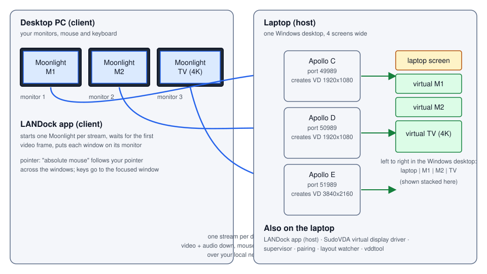

# LANDock

**Use your laptop's virtual monitors on your desktop PC, over your home network.**

LANDock makes a Windows laptop (the *host*) create extra virtual monitors and stream each one over the local network
to a Windows desktop PC (the *client*), where each stream fills one of the desktop's real monitors. Your desktop's
mouse and keyboard then drive the laptop as if the screens were attached to it: one extended workspace, no internet
needed.

> **Status: experimental (v0.1).** Everything has been tested on one laptop with the host and the client on the same
> machine (three streams, mouse sweeps across all displays, Notepad windows dragged between displays and typed into).
> The first test with a second PC is still to come. Please open an issue with what you find.

## What you get

- Up to **three** virtual displays today (two 1080p monitors and a 4K TV by default; resolution, refresh rate and
  bitrate are settings), placed **laptop | M1 | M2 | TV**, left to right, whatever order they connect in.
- **Seamless pointer and keyboard**: move the mouse off your desktop's monitor onto a stream and it keeps moving
  across the laptop's displays; typing goes to the window under focus.
- A **tray icon and settings window** for everything, plus a command line.
- **Automatic updates** (checked every few minutes; installed after you agree, or automatically if you choose), where
  only the parts that changed are downloaded.
- A **Windows installer** that needs no administrator rights.

## Install

You need two Windows 10/11 PCs on the same network. Download `LANDock-Setup-<version>.exe` from the
[latest release](../../releases/latest) and run it on **both**:

| On the laptop (host) | On the desktop PC (client) |
|---|---|
| Choose *Laptop only* (or both). Tick the firewall option (Windows asks for permission once). | Choose *Desktop PC only* (or both). |
| Install the **virtual display driver once**: install [Apollo](https://github.com/ClassicOldSong/Apollo/releases) from its release (its installer adds the SudoVDA driver). LANDock does not install drivers. | Nothing else. |

The installer and the programs are not code-signed yet, so Windows SmartScreen may show a warning the first time
("More info" > "Run anyway").

## Use

1. **Laptop:** click the LANDock tray icon > *Start host*. The Host tab shows a 4-digit **pairing PIN** and the laptop's
   network address.
2. **Desktop PC:** open the LANDock settings > *Client*. Enter the laptop's address, the PIN, press *Pair* (once per
   desktop PC). Check the monitor numbers in the table, then press *Start displays*.
3. Each laptop display now fills a monitor of the desktop. Click once in a window to give it the keyboard.
   *Stop displays* ends the streams and removes the virtual displays.

New desktop PCs can only pair while the pairing window is open (10 minutes after the host starts, or after *New
pairing PIN*). Paired desktops are fully trusted: they control the laptop.

Command line (for scripts): `LANDock host up`, `LANDock client pair --pin 1234`, `LANDock client start`,
`LANDock client status`, `LANDock update check`. Run `LANDock help` for the list.

## Updates

The app asks GitHub for the newest release every 10 minutes (Updates tab: interval, ask or install automatically,
pre-releases). Each release lists a version and checksum for three parts (the app, the host, the client); only the parts
that changed are downloaded and installed, and host and client parts wait until nothing is streaming when
installing automatically. A release is only offered after its checksum matched.

No access token is needed: the repository and its releases are public. (The Updates tab has an optional token field for a private copy of the repository.)

## How it works

See [docs/how-it-works.md](docs/how-it-works.md): why there is one Apollo per display, how the pointer lines up, how
pairing is kept safe, how the updater and installer work. In short:

- **Host** = [Apollo](https://github.com/ClassicOldSong/Apollo) (a Sunshine fork that creates a virtual display per
  client through the SudoVDA driver). LANDock runs **three instances** (one per display) and supervises, pairs and
  arranges them.
- **Client** = [Moonlight](https://github.com/moonlight-stream/moonlight-qt), one window per stream, each placed on a
  monitor and switched to fullscreen.
- **The LANDock app** glues them together and takes care of installing, configuring and updating.

## Build from source

[docs/building.md](docs/building.md). CI builds everything from source on every release: the app, Apollo and Moonlight
from our **forks** ([shohamh/Apollo](https://github.com/shohamh/Apollo),
[shohamh/moonlight-qt](https://github.com/shohamh/moonlight-qt)), which we keep in step with upstream
([docs/upstream-sync.md](docs/upstream-sync.md)).

## Credits

LANDock is mostly glue around other people's excellent work: **Apollo** and **Sunshine** (host), **Moonlight** (client),
**SudoVDA** (virtual display driver), Boost, MSYS2, .NET, Inno Setup, and the ideas of several community projects.
Full list with licences: [NOTICE.md](NOTICE.md). Implementation and testing were done pair-programming style with
Claude Code.

## Licence

[GPL-3.0](LICENSE), the licence of Apollo, Sunshine and Moonlight, which LANDock builds on and ships.
